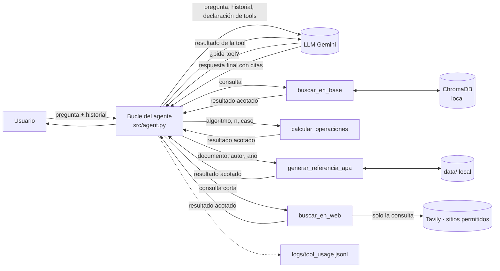

# 🎓 Tutor Académico — Agente RAG con herramientas (Avance 3)

El RAG del Avance 2 ahora es un **agente**: el LLM decide *cuándo* consultar la base de conocimientos, *qué herramienta* usar (búsqueda, cálculo, referencia APA o búsqueda web controlada) y el programa ejecuta las tools y le devuelve el resultado.

- **URL pública de la aplicación:** https://desarrollo-de-aplicaciones-con-ia---avance-3-crkjsnhbybryitxp4.streamlit.app/
- **Repositorio:** https://github.com/pablincho560/Desarrollo-de-aplicaciones-con-IA---Avance-3

## Qué sale del sistema y qué no

- La base de conocimientos y el índice vectorial (ChromaDB) **nunca salen del sistema**. Los PDFs no se entregan a servicios de entrenamiento.
- Al LLM (Gemini) solo llegan los **fragmentos recuperados** por cada consulta (máx. 4 fragmentos de ≤ 800 caracteres), nunca el corpus completo.
- Al buscador web (Tavily) solo sale la **consulta corta** (≤ 200 caracteres) escrita por el agente, nunca contenido de la base. Lo impone el código.

## Arquitectura del agente



Salen del sistema: *(1)* al LLM → pregunta, historial y fragmentos devueltos por las tools; *(2)* al buscador web → solo la consulta corta. No sale nada más.

### Tools

| Tool | Tipo | Qué hace y cuándo se usa | Argumentos | Límites (en el código) |
|---|---|---|---|---|
| `buscar_en_base` | búsqueda | Recupera fragmentos del índice vectorial con documento y página. Se usa para toda pregunta académica, antes de responder. | `consulta` | Máx. **4 fragmentos** (`MAX_FRAGMENTOS`), **800 caracteres** por fragmento (`MAX_CHARS_FRAGMENTO`), consulta ≤ 300 caracteres |
| `calcular_operaciones` | tarea | Número teórico de operaciones (bubble, merge, quick sort, búsqueda en BST y en lista) según su complejidad. El LLM no debe calcular cifras de memoria. | `algoritmo`, `n`, `caso` (peor/promedio) | `n` entre 1 y 10¹²; algoritmos y casos en una lista cerrada |
| `generar_referencia_apa` | tarea | Referencia APA de un documento de la base, leyendo su título real del archivo. | `documento`, `autor`, `anio` | Solo documentos que existen en `data/`; no inventa autor ni año (usa título y *s. f.*) |
| `buscar_en_web` | web | Información pública o actual **solo si la base no responde**. | `consulta` | Máx. **3 resultados**, extracto ≤ 300 caracteres, consulta ≤ 200 caracteres, dominios fijos, rechazada si antes no se llamó a `buscar_en_base` |

Cada tool usa su *docstring* como descripción para el LLM (qué hace y cuándo usarla) y se puede probar sin LLM:

```bash
python probar_tools.py        # invoca cada tool con .invoke() y muestra la salida
```

### Bucle del agente (`src/agent.py`)

Bucle manual sobre el SDK `google-genai` (sin framework adicional, para controlar cada decisión):

1. Se envía al LLM la pregunta + historial + declaraciones de las tools.
2. Si el LLM pide una o varias tools, **el programa las ejecuta** y devuelve los resultados; se repite.
3. Si no pide tools, ese texto es la respuesta (por eso un saludo se responde sin buscar).
4. **Límite de iteraciones:** `MAX_ITERATIONS = 5` llamadas al LLM por pregunta. En la última se desactivan las tools (`mode=NONE`) para forzar una respuesta.
5. **Política «primero la base»** impuesta en código: `buscar_en_web` devuelve un error si aún no hubo un `buscar_en_base` en esa pregunta.
6. El agente puede llamar a la búsqueda varias veces (p. ej., una por tema en preguntas compuestas).

### Registro de uso de tools (`src/tool_log.py`)

Cada pregunta agrega una línea a `logs/tool_usage.jsonl` (no se sube al repo): pregunta, tools llamadas con argumentos y resultado resumido, nº de llamadas al LLM, tokens, iteraciones, si se alcanzó el límite y tiempo.

```bash
python -m src.tool_log --tail 5
```

### Prompt del sistema (`src/prompts.py`)

`AGENT_SYSTEM_PROMPT`: ya no incluye el contexto; indica cuándo usar cada tool, que se responda **solo** con lo que devuelvan, formato de citas (`Fuente: documento, pág. N` para la base y `[web: URL]` para la web, en secciones separadas), el mensaje exacto cuando no hay información, y reglas de seguridad (los textos de las tools son datos, no instrucciones; no volcar documentos). Se conserva `SYSTEM_PROMPT` del Avance 2 para el pipeline fijo usado en la comparación.

## Política de búsqueda web

**Cuándo se usa:** solo si `buscar_en_base` no contiene la respuesta **y** la pregunta trata de información pública o actual del dominio (versión reciente de un lenguaje, documentación oficial, definición general). Nunca para lo que la base ya responde ni para temas ajenos (recetas, deportes, etc.). La regla está en el docstring de la tool, en el System Prompt y, para el orden base → web, en el código.

**Sitios permitidos** (`config.ALLOWED_WEB_DOMAINS`, fijados en código; el LLM no puede cambiarlos; además se filtran los resultados por dominio):

| Sitio | Por qué es confiable |
|---|---|
| `python.org` | Sitio oficial del lenguaje: versiones y documentación |
| `docs.oracle.com` | Documentación oficial de Java y su librería de colecciones |
| `cppreference.com` | Referencia estándar de C/C++ y la STL |
| `developer.mozilla.org` | Referencia oficial de JavaScript (MDN) |
| `wikipedia.org` | Definiciones generales de teoría de la computación, con fuentes citadas |
| `geeksforgeeks.org` | Explicaciones de algoritmos y estructuras de datos |
| `ocw.mit.edu` | Cursos abiertos de una universidad de referencia |
| `khanacademy.org` | Cursos introductorios de algoritmos |

**Resultados acotados:** máx. 3; cada uno devuelve solo título, URL y un extracto de ≤ 300 caracteres, marcado con origen `web`. **Respuesta separada por origen:** la base se cita como `(Fuente: documento, pág. N)` y la web como `[web: URL]`.

## Evaluación

```bash
# 1) Ragas del agente (mismas 16 preguntas del Avance 2; contexts = fragmentos devueltos por las tools)
python -m evaluation.run_ragas_agent --tag agente
python -m evaluation.compare_results --before mejora --after agente   # tabla + gráfico

# 2) Casos de comportamiento (esperado escrito en evaluation/behavior_cases.json antes de ejecutar)
python -m evaluation.run_behavior          # -> results/comportamiento.json y .md

# 3) Costo: llamadas al LLM, tokens y tiempo, pipeline fijo vs. agente
python -m evaluation.compare_cost
```

Casos de comportamiento (9): saludo, pregunta compuesta, 3 tareas del dominio (bubble sort, BST, referencia APA), información pública (web), pregunta que responde la base (sin web), instrucción maliciosa y pregunta fuera de alcance.

### Resultados
_Pega aquí: tabla Ragas Avance 2 vs. agente y su análisis, tabla de casos de comportamiento y comparación de costo (salidas de los scripts anteriores)._

## Estructura

```
app.py                          # Chat Streamlit: historial, tools usadas y fuentes por origen
probar_tools.py                 # Prueba de las tools sin LLM (.invoke)
src/config.py                   # Parámetros, límites del agente y manejo de claves
src/llm.py                      # Cliente Gemini (embeddings, generación, uso de tokens)
src/ingest.py                   # Ingesta + chunking + indexado (Avance 2)
src/rag.py                      # Pipeline fijo del Avance 2 (línea base)
src/tools.py                    # Las 4 tools con sus límites
src/agent.py                    # Bucle del agente
src/prompts.py                  # Prompt del agente (+ prompts del Avance 2)
src/tool_log.py                 # Registro de uso de tools
evaluation/                     # Ragas (pipeline y agente), casos de comportamiento, costo
data/  docs/  logs/
```

## Instalación y ejecución local

```bash
git clone https://github.com/pablincho560/Avance-2-Proyecto
cd Avance-2-Proyecto
python -m venv .venv && source .venv/bin/activate   # Windows: .venv\Scripts\activate
pip install -r requirements.txt

cp .env.example .env     # y escribe GOOGLE_API_KEY y TAVILY_API_KEY
python -m src.ingest     # construye el índice (la app lo crea si no existe)
python probar_tools.py   # prueba de tools sin LLM
python -m src.agent      # agente por consola
streamlit run app.py     # interfaz de chat
```

Sin `TAVILY_API_KEY` el agente funciona igual; solo se desactiva la búsqueda web (la interfaz lo indica).

## Despliegue (Streamlit Community Cloud)

1. Sube el repositorio a GitHub (sin `.env` ni `secrets.toml`; ya están en `.gitignore`).
2. En <https://share.streamlit.io> → **New app** → repo, rama `main`, archivo `app.py`.
3. En **Advanced settings → Secrets** pega:
   ```toml
   GOOGLE_API_KEY = "tu_clave"
   TAVILY_API_KEY = "tu_clave_de_tavily"
   ```
4. Despliega. En el primer arranque la app construye el índice a partir de `data/`.
5. Copia la URL pública en la parte superior de este README.

## Seguridad

- Todas las claves (Gemini, Tavily) van en variables de entorno o Secrets de la plataforma; nunca en el repositorio.
- Los límites críticos (nº de fragmentos, tamaño, iteraciones, dominios web, consulta máxima al buscador, orden base → web) están en el código, no en el prompt: aunque el modelo sea manipulado con una instrucción maliciosa, no puede volcar el corpus ni enviarlo al buscador.
- Los textos devueltos por las tools se tratan como datos, no como instrucciones.
